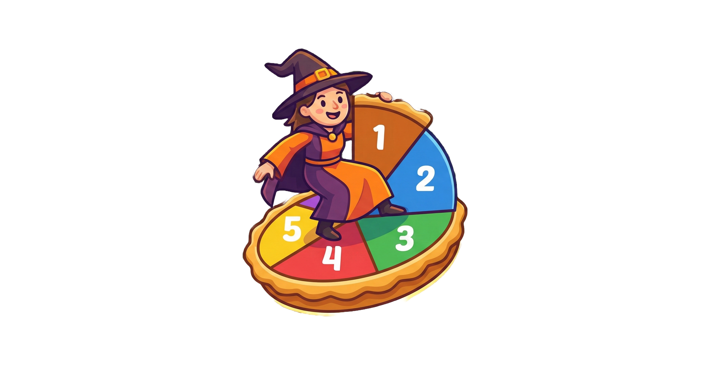
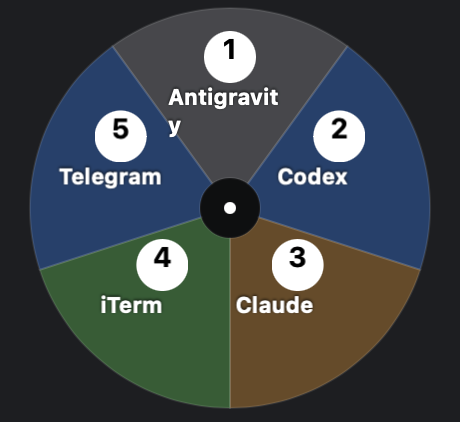

<p align="center">
  
</p>

# PiSwitch

PiSwitch is a radial pie-menu app switcher for macOS and Windows. Press a hotkey, flick toward the app you want and release, or press the number on its slice. You can keep several menus, such as `default`, `messaging`, and `finder-groups`, each with its own hotkey. Both platforms read the same JSON config format.

<p align="center">
  
</p>

## macOS

Building requires the Xcode command-line tools (`xcode-select --install`).

```bash
./scripts/build.sh          # build the app
./scripts/init-config.sh    # create config/instances/*.json from the examples
```

Edit the menus in `config/instances/`: `default.json` for your main apps, `messaging.json` for chat apps, and `finder-groups.json` for Finder locations. Then open a menu by name:

```bash
./scripts/piswitch-launcher.sh              # default menu
./scripts/piswitch-launcher.sh messaging
```

### Hotkeys with Karabiner-Elements

`examples/karabiner/hyper-piswitch-rule.json` maps Caps Lock to Hyper (`Cmd+Ctrl+Opt+Shift`) and binds Hyper+R, Hyper+H, and Hyper+G to the default, messaging, and finder-groups menus. Copy the rule into your Karabiner config and replace `REPLACE_WITH_ABSOLUTE_PATH` with the path to your checkout.

### Finder groups

Entries in the `finder-groups` menu, such as `home` or `projects`, open Finder locations instead of apps. Each name resolves to a stub bundle at `assets/finder-groups/<name>.app`, or at `../bin/finder-groups/<name>.app` next to the checkout.

## Windows

Building requires the [.NET 8 SDK](https://dotnet.microsoft.com/download/dotnet/8.0).

```powershell
.\scripts\build-windows.ps1    # produces dist\bin-windows\PiSwitch.exe
.\scripts\setup-windows.ps1    # install, enable auto-start, and launch
```

Setup copies the example menus to `config\instances\` without overwriting existing ones, installs `PiSwitch.exe` to `%LOCALAPPDATA%\PiSwitch\`, adds a startup shortcut, records the checkout in `PISWITCH_HOME` and `%LOCALAPPDATA%\PiSwitch\piswitch-home.txt`, and starts PiSwitch in the system tray. It also keeps a copy of your menus beside the installed executable, which PiSwitch uses if the checkout is unavailable at logon.

The tray icon offers **Show Menu**, **Reload Config**, and **Exit**. Running `PiSwitch.exe` while it is already running shows the menu instead of starting a second copy.

### Hotkeys with AutoHotkey

PiSwitch listens for a named Windows event, `Local\PiSwitch_show_<menu>`. `examples\autohotkey\hyper-piswitch.ahk` is a complete example; to add a trigger to your own script (AutoHotkey v2):

```ahk
#r:: {
    static EVENT_MODIFY_STATE := 0x0002
    hEvent := DllCall("OpenEvent", "UInt", EVENT_MODIFY_STATE, "Int", 0, "Str", "Local\PiSwitch_show_default", "Ptr")
    if (hEvent) {
        DllCall("SetEvent", "Ptr", hEvent)
        DllCall("CloseHandle", "Ptr", hEvent)
    }
}
```

Replace `default` with another menu name to open that menu. If your AutoHotkey script runs elevated, start PiSwitch through Explorer with `--start-only` rather than as a child process; otherwise PiSwitch and every app it launches inherit elevation.

## Config format

A menu lists 2–8 apps. Colors, labels, and executable paths are optional:

```json
{
  "apps": ["Chrome", "Visual Studio Code", "Windows Terminal", "Slack", "Spotify"],
  "colors": {
    "Chrome": "#FFCC00",
    "Visual Studio Code": "systemBlue"
  },
  "labels": {
    "Visual Studio Code": "VS Code"
  },
  "paths": {
    "MyApp": "C:\\Program Files\\MyApp\\myapp.exe"
  }
}
```

| Field | Meaning |
|---|---|
| `apps` | App names, in slice order. Many common apps have built-in colors and short labels. |
| `colors` | Hex (`#RGB`, `#RRGGBB`, `#RRGGBBAA`) or a named color such as `systemBlue` or `teal`. |
| `labels` | Text shown on a slice in place of the app name. |
| `paths` | Windows only: an executable for an app that has no Start Menu shortcut. |

On Windows, choosing an app brings its existing window forward, including apps that only show a tray icon. If the app is not running, PiSwitch starts it from its Start Menu shortcut or the configured path.

## Project layout

```
Sources/PiSwitch/main.swift   macOS app (Swift)
windows/PiSwitch/             Windows app (C#/WPF, .NET 8)
scripts/                      build, setup, config init, launcher, and test scripts
config/examples/              example menus (copied to config/instances/, which is gitignored)
examples/                     Karabiner-Elements and AutoHotkey hotkey examples
assets/                       logo, screenshot, and Finder group stubs
```

Checks: `./scripts/smoke-test.sh` on macOS and `.\scripts\test-windows.ps1` on Windows.

## License

MIT. See `LICENSE`.
